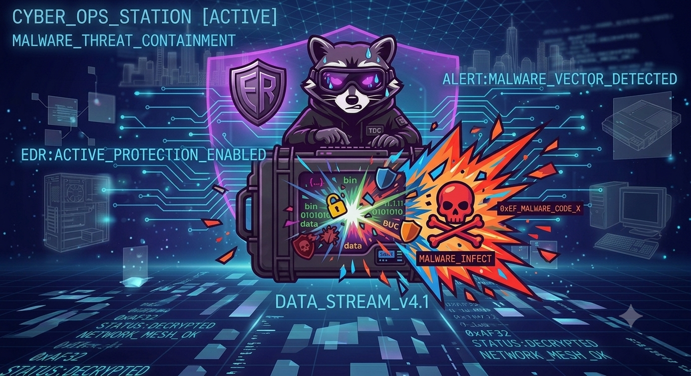

 The Transportable Detonation Chamber (TDC) is a pre-configured Windows 11 VM that runs a sample while every engine on the box watches it: Sigma, YARA and IOC rules in real time, kernel ETW telemetry, Sysmon, a sandbox, and four scanners that read the memory of the running process. One Web UI on port 9000 shows all of it — the alerts, the process tree, the pipes the sample opened, its memory, its bytes — and turns it into one verdict with the evidence that produced it. It runs on Hyper-V on an x86_64 Windows host, and under UTM on Apple Silicon.

I built it to answer two questions with the same box. The first is the obvious one: *what did this sample do*. The second is the one I reach for more often: *what does my own payload look like to the engines watching it* — which rule fires, which byte Defender hates, and whether anybody would have seen it in memory at all. This post is the tour, told as those two runs.


> The chamber executes what you hand it, on purpose. `/api/submit` runs files by design and the Web UI has no login. Treat the VM as compromised from the first detonation, and never put it on a network you care about.

- [Why a Box of My Own](#why-a-box-of-my-own)
- [What Runs Inside](#what-runs-inside)
- [Act 1: One Sample, End to End](#act-1-one-sample-end-to-end)
- [Act 2: My Own Payload Against the Same Engines](#act-2-my-own-payload-against-the-same-engines)
- [The Rest of the Box](#the-rest-of-the-box)
- [Running It](#running-it)
- [What I Would Change Next](#what-i-would-change-next)
- [Links](#links)

## Why a Box of My Own

Detonating a sample against several engines is not hard. Reading the result is. Sysmon writes to an event log, a YARA scanner prints to a console, a kernel ETW agent streams NDJSON into a directory, and a sandbox returns a report — four interfaces, four clocks, four ideas of what a process is. The work that actually tells you something, lining those up for one PID, is the work nobody wants to do twice, which in practice means it happens once and badly.

The second problem is the one that made me build the memory side. Asking "does my payload get caught" has no answer until you say *by what*. Static detection, a Sigma rule on the command line, a YARA hit in memory, a beacon that ticks like a clock, a pipe name that is in everybody's signature set — those are five different questions with five different answers, and an EDR console that says CLEAN is only reporting on the one it asked.

So the box grades findings itself instead of believing each scanner's severity label. Every finding from every source goes through one model: it gets weighed by what kind of evidence it is, by how persistently it shows up, and by whether a second, independent source agrees — and anything the clean host produces on its own is set aside before the counting starts. The result is a number on a scale that means the same thing for a piece of commodity malware and for something I compiled an hour ago. That is the part worth having.

## What Runs Inside

Everything but the browser runs inside the VM, and the host reaches all of it through port 9000.

<div class="ghidra-mock" style="overflow-x:auto;">
  <div class="gm-bar">
    <span style="color:#ff5f56">●</span>&nbsp;<span style="color:#ffbd2e">●</span>&nbsp;<span style="color:#27c93f">●</span>
    <span style="margin-left:12px;color:#8b949e;font-size:11px;font-family:'Courier New',monospace;">Windows 11 VM · Hyper-V x64 / UTM ARM64</span>
  </div>
  <div style="padding:20px 22px 24px;">

    <!-- Intake layer -->
    <div style="color:#484f58;font-size:10px;text-transform:uppercase;letter-spacing:2px;margin-bottom:12px;font-family:'Courier New',monospace;">Intake</div>

    <div style="display:flex;gap:10px;flex-wrap:wrap;align-items:stretch;">

      <div style="flex:1;min-width:130px;background:#0c1829;border:1px solid #1d4ed8;border-radius:6px;padding:12px 14px;">
        <div style="color:#60a5fa;font-family:'Courier New',monospace;font-size:13px;font-weight:600;">Web UI</div>
        <div style="color:#3b82f6;font-family:'Courier New',monospace;font-size:11px;margin-top:2px;">:9000</div>
        <div style="color:#4b5563;font-size:11px;margin-top:8px;">Python / Flask</div>
        <div style="color:#374151;font-size:10px;margin-top:2px;">17 tabs &amp; the REST API</div>
      </div>

      <div style="display:flex;align-items:center;color:#f97316;font-size:18px;font-weight:700;padding:0 2px;">→</div>

      <div style="flex:1.4;min-width:155px;background:#1a0a00;border:1px solid #c2410c;border-radius:6px;padding:12px 14px;">
        <div style="color:#fb923c;font-family:'Courier New',monospace;font-size:13px;font-weight:600;">DetonatorAgent</div>
        <div style="color:#f97316;font-family:'Courier New',monospace;font-size:11px;margin-top:2px;">:8080</div>
        <div style="color:#4b5563;font-size:11px;margin-top:8px;">.NET 8.0</div>
        <div style="color:#374151;font-size:10px;margin-top:2px;">Runs the sample · answers its PID</div>
      </div>

      <div style="flex:0 0 10px;"></div>

      <div style="flex:1;min-width:130px;background:#03180d;border:1px solid #166534;border-radius:6px;padding:12px 14px;">
        <div style="color:#4ade80;font-family:'Courier New',monospace;font-size:13px;font-weight:600;">LitterBox</div>
        <div style="color:#22c55e;font-family:'Courier New',monospace;font-size:11px;margin-top:2px;">:1337</div>
        <div style="color:#4b5563;font-size:11px;margin-top:8px;">Python / Flask</div>
        <div style="color:#374151;font-size:10px;margin-top:2px;">Static + dynamic sandbox</div>
      </div>

    </div>

    <div style="display:flex;align-items:center;padding:14px 0;gap:10px;">
      <div style="flex:1;height:1px;background:#21262d;"></div>
      <div style="color:#484f58;font-size:10px;font-family:'Courier New',monospace;white-space:nowrap;">▼&nbsp;&nbsp;events · telemetry · alerts&nbsp;&nbsp;▼</div>
      <div style="flex:1;height:1px;background:#21262d;"></div>
    </div>

    <!-- Detection layer -->
    <div style="color:#484f58;font-size:10px;text-transform:uppercase;letter-spacing:2px;margin-bottom:12px;font-family:'Courier New',monospace;">Detection</div>

    <div style="display:flex;gap:10px;flex-wrap:wrap;align-items:stretch;">

      <div style="flex:1;min-width:155px;background:#130606;border:1px solid #991b1b;border-radius:6px;padding:12px 14px;">
        <div style="color:#fca5a5;font-family:'Courier New',monospace;font-size:13px;font-weight:600;">Rustinel</div>
        <div style="color:#f87171;font-family:'Courier New',monospace;font-size:11px;margin-top:2px;">Sigma · YARA · IOC</div>
        <div style="color:#4b5563;font-size:11px;margin-top:8px;">Rust</div>
        <div style="color:#374151;font-size:10px;margin-top:2px;">Hot-reloaded rules</div>
        <div style="color:#374151;font-size:10px;">NDJSON alerts, read every 5 s</div>
      </div>

      <div style="flex:1;min-width:155px;background:#170530;border:1px solid #7c3aed;border-radius:6px;padding:12px 14px;">
        <div style="color:#c084fc;font-family:'Courier New',monospace;font-size:13px;font-weight:600;">Fibratus</div>
        <div style="color:#a78bfa;font-family:'Courier New',monospace;font-size:11px;margin-top:2px;">:8180 · Kernel ETW</div>
        <div style="color:#4b5563;font-size:11px;margin-top:8px;">Go</div>
        <div style="color:#374151;font-size:10px;margin-top:2px;">Process / file / registry / network</div>
        <div style="color:#374151;font-size:10px;">Behaviour rules</div>
      </div>

      <div style="flex:1;min-width:130px;background:#161000;border:1px solid #b45309;border-radius:6px;padding:12px 14px;">
        <div style="color:#fcd34d;font-family:'Courier New',monospace;font-size:13px;font-weight:600;">Sysmon</div>
        <div style="color:#fbbf24;font-family:'Courier New',monospace;font-size:11px;margin-top:2px;">Event Log, 512 MB</div>
        <div style="color:#4b5563;font-size:11px;margin-top:8px;">Sysinternals</div>
        <div style="color:#374151;font-size:10px;margin-top:2px;">Every named pipe logged</div>
        <div style="color:#374151;font-size:10px;">ARM64 native binary</div>
      </div>

    </div>

    <div style="display:flex;align-items:center;padding:14px 0;gap:10px;">
      <div style="flex:1;height:1px;background:#21262d;"></div>
      <div style="color:#484f58;font-size:10px;font-family:'Courier New',monospace;white-space:nowrap;">▼&nbsp;&nbsp;against the PID, one after another&nbsp;&nbsp;▼</div>
      <div style="flex:1;height:1px;background:#21262d;"></div>
    </div>

    <!-- Memory layer -->
    <div style="color:#484f58;font-size:10px;text-transform:uppercase;letter-spacing:2px;margin-bottom:12px;font-family:'Courier New',monospace;">Memory</div>

    <div style="display:flex;gap:10px;flex-wrap:wrap;align-items:stretch;">

      <div style="flex:1;min-width:120px;background:#04171a;border:1px solid #0e7490;border-radius:6px;padding:12px 14px;">
        <div style="color:#67e8f9;font-family:'Courier New',monospace;font-size:12px;font-weight:600;">Hunt-Sleeping-Beacons</div>
        <div style="color:#4b5563;font-size:11px;margin-top:8px;">C++</div>
        <div style="color:#374151;font-size:10px;margin-top:2px;">Callstacks of sleeping beacons</div>
      </div>

      <div style="flex:1;min-width:120px;background:#04171a;border:1px solid #0e7490;border-radius:6px;padding:12px 14px;">
        <div style="color:#67e8f9;font-family:'Courier New',monospace;font-size:12px;font-weight:600;">BeaconEye</div>
        <div style="color:#4b5563;font-size:11px;margin-top:8px;">.NET</div>
        <div style="color:#374151;font-size:10px;margin-top:2px;">Cobalt Strike beacon configs</div>
      </div>

      <div style="flex:1;min-width:120px;background:#04171a;border:1px solid #0e7490;border-radius:6px;padding:12px 14px;">
        <div style="color:#67e8f9;font-family:'Courier New',monospace;font-size:12px;font-weight:600;">Aether</div>
        <div style="color:#4b5563;font-size:11px;margin-top:8px;">Zig</div>
        <div style="color:#374151;font-size:10px;margin-top:2px;">380 in-memory signatures</div>
        <div style="color:#374151;font-size:10px;">3 samples, 3 s apart</div>
      </div>

      <div style="flex:1;min-width:120px;background:#04171a;border:1px solid #0e7490;border-radius:6px;padding:12px 14px;">
        <div style="color:#67e8f9;font-family:'Courier New',monospace;font-size:12px;font-weight:600;">Process Dump</div>
        <div style="color:#4b5563;font-size:11px;margin-top:8px;">C++</div>
        <div style="color:#374151;font-size:10px;margin-top:2px;">Writes components to disk</div>
        <div style="color:#374151;font-size:10px;">Skips clean-hash modules</div>
      </div>

      <div style="flex:1;min-width:120px;background:#1a0618;border:1px solid #a21caf;border-radius:6px;padding:12px 14px;">
        <div style="color:#f0abfc;font-family:'Courier New',monospace;font-size:12px;font-weight:600;">Exit Capture</div>
        <div style="color:#4b5563;font-size:11px;margin-top:8px;">Windows feature</div>
        <div style="color:#374151;font-size:10px;margin-top:2px;">Full dump as the process exits</div>
        <div style="color:#374151;font-size:10px;">Armed per image name</div>
      </div>

    </div>

  </div>
</div>

| Service | Port | Purpose | Technology |
|---------|------|---------|-----------|
| **Web UI** | 9000 | The 17 tabs, the REST API and the MCP endpoint | Python / Flask |
| **DetonatorAgent** | 8080 | Executes the sample, returns its PID | .NET 8.0 |
| **LitterBox** | 1337 | Static + dynamic analysis sandbox | Python / Flask |
| **Fibratus** | 8180 | Kernel ETW telemetry and behaviour rules | Go |
| **Rustinel** | — | Sigma / YARA / IOC detection in real time | Rust |
| **Sysmon** | — | Windows event logging, incl. every named pipe | Sysinternals |
| **Hunt-Sleeping-Beacons** | — | Callstack scanner for sleeping C2 beacons | C++ |
| **BeaconEye** | — | Cobalt Strike beacon config scanner | .NET |
| **Aether** | — | Live-process memory forensics | Zig |
| **Process Dump** | — | Memory component dumper with a clean-hash database | C++ |
| **Detonator** | 5000 / 8000 | Orchestration UI and REST API | Python |
| **theZoo-WebUI** | 8888 | Malware sample browser | PHP |

A detonation is a fan-out, not a pipeline. The hash goes into the IOC list, Windows gets armed to dump the process the moment it exits, and only then does anything run:

<pre class="mermaid">
flowchart TB
    SUBMIT["Submit tab, make submit or the MCP tool"] --> IOC["The sample's SHA-256 joins Rustinel's IOC list"]
    IOC --> ARM["Exit Capture armed for the image name, for a window of 120 s"]
    ARM --> RUN["DetonatorAgent runs the file and answers its PID"]
    RUN --> ENGINES["Rustinel, Fibratus and Sysmon record all the time; their output is matched to the PID afterwards"]
    RUN --> MEM["Against the PID, one after another in one background thread: Hunt-Sleeping-Beacons, BeaconEye, Aether with 3 samples 3 s apart, Process Dump last"]
    RUN --> LB["LitterBox: upload, then static, then dynamic analysis"]
    RUN --> EXIT["Exit Capture waits for the dump until the window closes, then reads it"]
    RUN --> LOG["From the Sysmon log: the connections it made and the pipes it opened"]
    ENGINES --> RESULTS["The results route"]
    MEM --> RESULTS
    LB --> RESULTS
    EXIT --> RESULTS
    LOG --> RESULTS
    RESULTS --> VERDICT["One verdict, filling in as the stages report"]
</pre>

The memory tools run one after another in a single background thread on purpose: three scanners reading the same process at the same time would each see the others' handles and allocations. Live-memory results arrive one to two minutes after the start, and the verdict rises while they come in.

## Detection Engines

| Engine | Technology | Capabilities |
|--------|-----------|-------------|
| **Rustinel** | Rust + ETW | 20 Sigma rules, 717 YARA rules, IOC hash matching, real-time NDJSON alerts |
| **Fibratus** | Go + Kernel ETW | Process/file/registry/network telemetry, behavior rules |
| **Sysmon** | Sysinternals | Event logging (process creation, network, file, registry, image loads) |
| **LitterBox** | Python | Static (YARA, strings) + Dynamic (PE-Sieve, Moneta, HollowsHunter, RedEdr) |

Detection rule coverage includes 14 process_creation rules (encoded PowerShell, schtasks, LOLBins, credential dumping), 3 registry_event rules (Run key persistence, Defender tampering, WDigest), plus task_creation, ps_script, and service_creation rules.

## Web UI

The single-page dark-themed interface aggregates telemetry from all engines across seven tabs:

### Dashboard

Stats strip showing alerts by severity, active processes, service health, loaded rules, and available tools. Six service health cards provide at-a-glance status for all detection components, and a recent activity feed shows detection alerts with severity coloring and rule names.


### Tracing & Detection

Real-time ETW event console with process filtering, timeline visualization, and click-through to full detail panels including raw JSON, ATT&CK tags, and related processes.


### Process Graph

Interactive process relationship visualization with 5 layout modes (Force-directed, Hierarchical, Radial, Circular, Grid), zoom controls, search by name/PID, time-range filtering, and detail panels for each process node.

### Scanner

ThreatCheck + DefenderCheck integration identifies the exact bytes triggering Defender/AMSI detection. Results show detection status, byte offset of the trigger, and link directly to the hex editor for inspection.

### Hex Editor & Binary Analysis

Full binary file viewer with drag-and-drop upload, data inspector (Int8/16/32/64, Float32/64, ASCII, UTF-16), and deep PE/ELF analysis capabilities.


### PE Analysis

Parses full PE structure including DOS/File/Optional headers, section table with entropy bars, security feature detection (ASLR/DEP/SEH/CFG), suspicious import categorization, packer identification, and RWX section flagging.


### Submit & Detonation

Multi-target sample detonation with stage-by-stage progress tracking (Upload, Execute, Static, Dynamic, EDR). Supports DetonatorAgent only, LitterBox only, or both targets simultaneously.


## Analysis Capabilities

Beyond basic detection, TDC provides deep binary analysis:

- **PE Header Analysis** — DOS/File/Optional headers, section table with entropy bars, ASLR/DEP/SEH/CFG detection
- **ELF Binary Analysis** — ELF32/64 header, program headers, section table, dynamic linking, symbol imports/exports
- **ELF Security Audit** — PIE, NX stack, RELRO (Full/Partial), stack canary, Fortify, stripped detection
- **Entropy Visualization** — Per-section Shannon entropy with color coding (red >= 7.0 indicates packed/encrypted)
- **Packer Identification** — UPX, Themida, VMProtect, ASPack, MPRESS via section name matching
- **Suspicious Import Detection** — Categorized by injection, evasion, credential access, networking, crypto, shellcode
- **Hunt-Sleeping-Beacons** — Callstack scanner for identifying sleeping C2 beacons (unbacked memory, module stomping, APC/Timer sleepmasks, return address spoofing)

## Reverse Engineering Tools

The VM comes pre-installed with:

- **Detect It Easy (DiE)** — PE/ELF/Mach-O identification (packers, compilers, protectors, linkers)
- **WinDbg Preview** — Kernel/user-mode debugger with crash dumps, live debugging, and TTD
- **Ghidra** — NSA reverse engineering framework for disassembly, decompilation, and scripting

## Quick Start

```bash
# macOS / Linux - Full VM
make up         # Provisions the Windows 11 VM (~20-30 min first boot)
make open       # Opens http://<vm-ip>:9000 in browser

# Windows (PowerShell, run as Administrator)
.\make.ps1 up
.\make.ps1 open

# Local UI development only (no VM needed)
make install    # Creates venv, installs Flask + deps
make run        # Starts on http://localhost:9000
```

## Detonation Workflow

1. Open the Web UI at `http://localhost:9000`
2. Navigate to the **Submit** tab
3. Drag and drop a malware sample
4. Select target: **Agent** (execution), **LitterBox** (analysis), or **Both**
5. Click Submit and watch the pipeline stages progress
6. Switch to **Tracing** for real-time ETW alerts
7. Switch to **Graph** for process relationship visualization
8. Check **Dashboard** for severity breakdown

CLI submission is also supported:

```bash
# macOS / Linux
make submit FILE=./samples/mimikatz.exe TARGET=both

# Windows
.\make.ps1 submit -File .\samples\mimikatz.exe -Target2 both
```

## Developer Experience

TDC is designed to be iterable for detection engineering work:

- **`make deploy-restart`** — Edit locally, push to VM, restart Flask in one command
- **`make run-debug`** — Flask auto-reload on file changes (local dev)
- **Loading Spinner** — Global overlay with 300ms delay threshold
- **Help Modal** — Built-in documentation (press "? Help" in sidebar)
- **Submissions History** — Persisted to JSON, with Hex button for quick inspection

## Platform Support

| Host OS | Hypervisor | Guest Arch | Performance |
|---------|-----------|-----------|-------------|
| Windows 10/11 (x86_64) | Hyper-V | x86_64 | Native |
| macOS Apple Silicon (M1-M4) | QEMU via vagrant-qemu | ARM64 | Near-native via hvf |

ARM64 compatibility: Sysmon runs natively (ARM64 binary), while Fibratus and Rustinel run under x86_64 emulation with ~10-20% overhead. .NET 8, Python 3.12, DetonatorAgent, and LitterBox all run natively on ARM64.

## Security Considerations

- Treat the VM as compromised after any detonation
- Use snapshots before each analysis session (`vagrant snapshot save clean_state`)
- Network isolation is recommended (Hyper-V internal/private switch)
- The Web UI has no authentication — bind to localhost or isolated networks only
- Defender exclusions are configured for detonation paths only
- Rustinel active response is disabled by default

## Demo

The following walkthroughs show TDC in action — from initial detonation through detection, analysis, and correlation.

### Service Dashboard


The main landing page shows a stats strip with total alerts, tracked processes, service health (online/degraded), loaded detection rules (Sigma + YARA), and available scanner tools. Six service health cards cover Rustinel, DetonatorAgent, LitterBox, Sysmon, Fibratus, and AV/AMSI Scanner — each displaying port, version, and quick-action buttons. The Recent Activity feed streams live detections with severity coloring (LOW for Sigma rules like Whoami Execution, CRITICAL for YARA hits like SuspiciousPEImports). The sidebar lists all tracked processes with alert counts and a color-coded timeline per engine.

### Sample Detonation (Mimikatz)


The Submit tab after detonating `mimikatz.exe` (1.3 MB) with target "Both (Agent + LitterBox)" and Fibratus EDR mode. The pipeline shows all 5 stages completed: DetonatorAgent execution (HTTP 200, PID 18612), LitterBox upload, Static Analysis (YARA + CheckPlz + Strings), Dynamic Analysis (PE-Sieve, Moneta, HollowsHunter), and Fibratus/Rustinel EDR (24 alerts). Below lists all CRITICAL detections — SuspiciousPEImports on docker.exe, mimikatz.exe, and gk.exe. Dynamic results include PE-Sieve (Suspicious: 0) and Moneta (IOCs: 0).

### Rustinel Trace Analysis


The Tracing console for a process scored "Malicious 100/100" with 23 events. Filter pills show severity breakdown ("23 Critical", "SuspiciousPEImports (23)"). A timeline bar visualizes event distribution by type (Critical/High, Process, Network, DNS, File, Registry). The verdict table lists each hit with severity, timestamp offset, rule name, and PID. Tabs allow switching between Live, HTTP Requests, Connections, DNS, Files, Registry, Artifacts, and Modules views.


The alert detail panel for a Sigma hit: "Example - Whoami Execution (CommandLine + Image)". Shows severity (Low), engine (SIGMA), PID (1304), process (whoami.exe), command line, parent info (powershell.exe PID 10912), and full parent command. MATCH DETAILS shows condition logic (`selection_img AND selection_cmd`) with JSON patterns. The EVENT section contains complete ECS fields (@timestamp, event.action: process-start, event.kind: alert, event.provider: etw).

### Process Relationship Graph


Hierarchical layout showing 178 nodes, 107 edges. Color-coded nodes represent different categories: blue squares (system processes — winlogon.exe, explorer.exe, userinit.exe), yellow/orange with red badges (malicious/detonated — fibratus.exe, MsMpEng.exe), green diamonds (network connections — pypi.org, github.com, loldrivers.io), and purple circles (DNS). Edge types: solid lines for process spawn, dashed for network connections, red for injection. Filters allow toggling Network, DNS, Files, Registry, and Detonated nodes. Time ranges span from 30s to All.


Force-directed layout with a selected process node (e.g. `docker.exe PID 1148`). The detail panel shows image path, process status (Exited), and activity breakdown (Threats, Network, DNS, File, Registry, Injection). Multiple large red nodes (processes with 21-24 alerts each) are surrounded by a dense network/DNS web connecting to destinations like discord.com, shodan.io, github.com, google.com, storage.googleapis, and more.

### PE Binary Analysis & Packer Detection


PE Header Analysis for a binary showing IOC flags detected — suspicious APIs categorized by privilege_escalation, defense_evasion, and shellcode, plus high entropy indicating packing. Three-column layout: FILE HEADER (architecture, timestamp, section count), OPTIONAL HEADER (PE type, entry point, linker version, subsystem), and SECURITY FEATURES (ASLR/DEP enabled, SEH status, CFG status, overall entropy). Section table with entropy bars and "Inspect" buttons for each section.


DiE-style detection overview with assessment badge (SUSPICIOUS/CLEAN). Detection cards identify compiler ("LINKER: Microsoft Visual C++ 6.0"), overlays, and protectors. An ENTROPY MAP color bar visualizes per-section entropy — green for low entropy sections (.text/.rdata), large red blocks for packed/compressed data (e.g. .ndata = NSIS compressed). FILE STRUCTURE shows a section layout diagram with legend (Code, Data, High Entropy, Overlay). Expandable sections include RICH HEADER entries.

### Section Inspection & Hex Editor


Section inspection expands in-line, showing metadata (Raw Offset, Raw Size, Virtual Address, Entropy) and characteristic badges (CNT_CODE, MEM_EXECUTE, MEM_READ). A live hex dump displays the first 4 KB with offsets, bytes, and ASCII representation, with "Load more..." for paging. Below the hex, extracted strings are listed (ASCII and UTF-16LE).


Raw hex editor showing 512-byte pages with offset navigation. The MZ header (4D 5A 90...) and DOS stub are visible with ASCII interpretation in the right column. The Data Inspector panel decodes the cursor position as Int8/16/32/64, Float32/64, ASCII, and UTF-16 LE. Quick-access buttons for PE/ELF Analysis sit in the toolbar alongside offset input and page navigation (Prev/Next).

### Sysmon Event Monitoring


The Sysmon tab displays captured events with filter pills by type: ProcessCreate, RegistryValueSet, FileCreate, NetworkConnect, DNSQuery. The table shows TIME, TYPE (color-coded), PID, IMAGE, DETAILS (full command lines), and Windows Event ID column (4688, 4689, 4663, 4656, 11707). Search, type/PID dropdowns, max events slider, and Refresh/Correlate buttons allow targeted investigation.


The detail panel for a FileCreate event shows timestamp, Sysmon Event ID, and originating image. "Correlated Windows Events" maps to related Security and Application log entries: 4663 "Object Access (File)", 4656 "Handle to Object Requested", and 11707 "Installation Completed (MSI)" — providing cross-log context for the same operation.

## API Reference

All endpoints are served on port `9000` and return JSON.

### Core Endpoints

| Method | Endpoint | Description |
|--------|----------|-------------|
| GET | `/api/alerts` | All detection alerts (Rustinel + Fibratus + LitterBox) |
| GET | `/api/processes` | Tracked processes with activity counts |
| GET | `/api/status` | Service health status (all components) |
| GET | `/api/rustinel` | Rustinel engine info (rules, version) |
| GET | `/api/submissions` | Submission history (last 200) |

### Submission & Detonation

| Method | Endpoint | Description |
|--------|----------|-------------|
| POST | `/api/submit` | Submit sample (multipart). Params: `file`, `target` (agent/litterbox/both) |
| GET | `/api/detonation/results` | Poll results. Params: `sha256`, `pid`, `litterbox_hash`, `filename` |

### Hex Editor & Binary Analysis

| Method | Endpoint | Description |
|--------|----------|-------------|
| GET | `/api/file/hex` | Hex dump. Params: `path`, `offset`, `bytes` |
| POST | `/api/file/hex/upload` | Upload file for hex viewing |
| GET | `/api/file/pe` | PE header analysis. Param: `path` |
| GET | `/api/file/elf` | ELF binary analysis. Param: `path` |

### Sysmon & Scanner

| Method | Endpoint | Description |
|--------|----------|-------------|
| GET | `/api/sysmon` | Sysmon events. Params: `max`, `event_id`, `pid` |
| GET | `/api/sysmon/stats` | Sysmon statistics and diagnostics |
| POST | `/api/scan/threatcheck` | ThreatCheck scan. Params: `file`/`path`, `engine`, `type` |
| POST | `/api/scan/defendercheck` | DefenderCheck scan. Params: `file`/`path` |
| GET | `/api/scan/status` | Scanner tool availability |

### Proxy Endpoints

| Method | Endpoint | Description |
|--------|----------|-------------|
| GET/POST | `/api/litterbox/<path>` | Proxy to LitterBox API (:1337) |
| GET | `/api/fibratus/<path>` | Proxy to Fibratus API (:8180) |

## Configuration

### Environment Variables

| Variable | Default | Description |
|----------|---------|-------------|
| `RUSTINEL_ALERTS_DIR` | `C:\tools\rustinel\logs` | Rustinel NDJSON alert directory |
| `RUSTINEL_INSTALL_DIR` | `C:\tools\rustinel` | Rustinel installation root |
| `DETONATOR_API` | `http://127.0.0.1:8000` | Detonator REST API |
| `DETONATOR_AGENT_API` | `http://127.0.0.1:8080` | DetonatorAgent API |
| `LITTERBOX_API` | `http://127.0.0.1:1337` | LitterBox API |
| `WEBUI_PORT` | `9000` | Web UI listen port |

### Custom Detection Rules

Detection rules support hot-reload — changes take effect without restarting services:

- **Sigma rules:** `C:\tools\detection-rules\rustinel-rules\dist\windows-advanced\rules\sigma\`
- **YARA rules:** `C:\tools\detection-rules\yara-combined\`
- **IOC hashes:** `C:\tools\detection-rules\rustinel-rules\dist\windows-advanced\rules\ioc\` (SHA-256, one per line)

## Links

- [GitHub Repository](https://github.com/BenjiTrapp/transportable-detonation-chamber)
